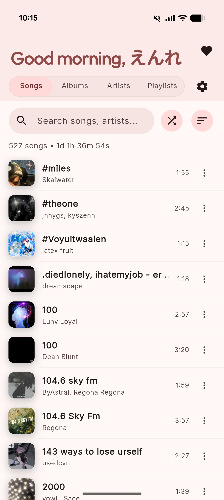
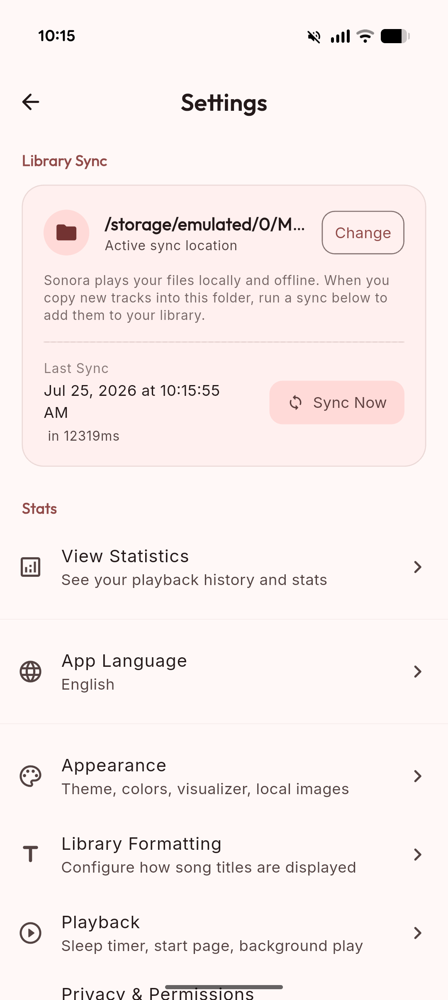

# Sonora

[](https://github.com/yurtemre7/sonora/actions/workflows/release.yml)

*🌐 Read this in: [日本語](README_JP.md)*

Sonora is a privacy-first local music player built with Flutter. It features a Material 3 Expressive design with dynamic album-art and Material You wallpaper theming, directory-based library sync, multi-band equalizer & sound effects (MFX), multi-select batch actions, and seamless background playback — all without ever copying or uploading your files. Android is the primary target, with Windows and iOS builds also supported (see [Platforms](#platforms)).

> [!NOTE]
> **AI Disclaimer:** This project is built entirely with AI assistance using Google's Antigravity agentic coding framework. All code, architecture decisions, and features were designed, implemented, and refined through AI-human pair programming.

## Platforms

| Platform | Status | Download |
|---|---|---|
| Android | Primary target | Release APKs on GitHub |
| iOS | Works, tested on a simulator only | Unsigned IPA in GitHub releases for [sideloading](#sideloading-the-ios-app), or [build it yourself](#ios) |
| Windows | Works | Not downloadable. [Build it yourself](#windows) |

New to the iOS version? Read **[Adding music on iOS](#adding-music-on-ios-how-to-guide)**: iOS apps can only read their own folder, so music has to be put there first.

## Screenshots

<p align="center">
  
  &nbsp;&nbsp;&nbsp;&nbsp;
  
</p>

## Features

### Library & Sync

- **Directory-Based Sync**: Point Sonora at any folder and play your music directly — no files are ever copied into app storage (on iOS, music lives in the app's own folder; see [Adding music on iOS](#adding-music-on-ios-how-to-guide)).
- **Incremental Sync**: Unchanged files are skipped using size and modification timestamps, keeping re-scans fast. All scanning runs in background isolates so the UI stays responsive.
- **Instant Launch**: Cached library data is available in milliseconds on startup; metadata and durations refresh asynchronously in the background.
- **Image Cache & Pre-Flight Service**: Background pre-flight caching pre-warms album artwork on library scan and sync completion (up to 150 MB / 250 images) ensuring buttery smooth list scrolling.
- **Wide Format Support**: Plays `.mp3`, `.m4a`, `.mp4`, `.aac`, `.flac`, `.ogg`, `.opus`, `.wav`, `.wma`, `.amr`, `.3gp`, `.ts`, `.mkv`, `.mid`, `.midi`, and more.
- **ID3 Metadata & Artwork**: Tags are parsed in background isolates and album art is cached to disk for fast loading.
- **Lyrics Detection**: Sidecar `.lrc` and `.txt` lyrics files are automatically detected during sync.
- **Manual & Automatic Resync**: Pull-to-refresh on any library tab, a *Sync Now* button in Settings, and a monthly reminder banner (snoozeable for 30 days).
- **Sync Details Panel**: Displays total library size, detected audio formats, unique dynamic theme count, and the number of lyrics-synced songs.
- **Onboarding**: A four-step first-run flow covering welcome, sync introduction, permissions, and folder selection.

### Library Browsing & Multi-Select

- **Four Main Tabs**: Songs, Albums (grid), Artists, and Playlists — all under a collapsible app bar.
- **Multi-Select Batch Actions**: Long-press any song to enter multi-select mode: bulk add to playlist, play next, queue, toggle favorite, or share via native system sheet.
- **Listening History (Recently Played)**: Dedicated history view tracking recently played tracks and play counts with full multi-select batch actions.
- **Dedicated Favorites Screen**: Integrated with `go_router` shell navigation, persistent mini-player support, and quick playback controls.
- **Search**: Per-tab live filtering with instant result counts and fast substring matching.
- **Sort Options**: Each tab has its own sort order (title, artist, duration, recently added, track count, and more) with an ascending/descending toggle. Preferences survive app restarts.
- **Album & Artist Detail Screens**: Blurred artwork backgrounds, play-all and shuffle-all actions, hero transitions, and an artist album carousel.
- **Playlist Management**: Drag-to-reorder tracks, play/shuffle actions, swipe-to-remove, M3U playlist import/export, and delete with confirmation.
- **Quick Shuffle**: One-tap shuffle from any tab header or detail screen.
- **Favorites**: Built-in Favorites playlist with toggle access from song tiles, batch actions, and an animated heart button in Now Playing.
- **Song Context Menu & Rich Info**: Play next, add to queue, add/remove from playlist, open containing folder in system file manager, copy absolute path, share audio file via native share sheet, and tap-to-copy individual metadata fields (bitrate, sample rate, format, path, size).
- **Active Track Highlighting**: Currently playing song is visually distinguished in all library lists.

### Playback & Audio Engine

- **Full Transport Controls**: Play/pause, next/previous, seek bar with elapsed and remaining time, shuffle, and repeat (off → all → one).
- **Audio Transitions & Clean Close**: Smooth audio pause/play fade transitions, plus a dedicated Player Close button to dismiss active playback and cleanly clear the system media notification.
- **Queue Management & Quick Scroll**: Standalone Queue screen and *Up Next* tab in Now Playing with drag-to-reorder, swipe-to-remove, active track highlighting, and one-tap **Scroll to Current Track**.
- **Audio Equalizer & MFX**: Built-in graphic equalizer presets (Lo-Fi, Warmth, Bass Boost) and customizable multi-band EQ with live pitch and playback speed controls.
- **Quick Music Effects (MFX) Presets**: One-tap speed & matching pitch presets via an enhanced enum: Super Slowed (0.70x), percentage-based steps (5%–25% slower/faster), Normal (1.00x), Sped Up (1.25x), Nightcore (1.30x), and Super Sped Up (1.50x).
- **Bluetooth Audio Device Patch**: Dedicated toggle to optimize equalizer filter headroom and volume output when streaming to Bluetooth audio devices.
- **Audio Focus & Interruption Safeguards**: Automatic pause on headphone disconnect, configurable ducking, resume on reconnect, and Android 14+ background interruption protection preventing silent playback.
- **Sleep Timer**: Choose from presets or set a custom duration. Supports notification actions (+1 min / cancel), "Finish Current Song" mode, and gentle end-of-song volume fade-out.
- **Haptic Playback Controls**: Optional tactile feedback on playback actions and item selections.
- **Startup State Restoration**: Toggle to remember and automatically restore the last played song, playback position, and queue state when reopening the app.
- **Related Tracks**: Surfaced suggestions for *From this album* and *More by this artist* in Now Playing.
- **Keep Playing on Close**: Optional setting to continue playback when dismissing the app from recents.

### Now Playing & UI

- **Material 3 Expressive Design**: Outfit and Inter typography, circular controls, blurred background artwork, and custom-styled sliders.
- **Global Mini Player**: Persistent bottom bar with live progress strip. Tap to expand, swipe up/down to open/dismiss, and swipe left/right to skip tracks.
- **Now Playing Sheet**: Full-screen modal with blurred artwork background, transport controls, and tabbed content: Lyrics, Up Next, and Related.
- **Multiple Player Layout Styles**: Modern, vinyl record style, or minimalist layout.
- **Unified Color Source & Theming**: 1-tap SegmentedButton controls for Theme Mode (System, Light, Dark) and Color Source (Material You system wallpaper extraction on Android 12+, Dynamic Album Art theming, or Custom Accent Color).
- **AMOLED Pure Black Mode**: Pitch-black backgrounds for OLED displays.
- **Lyrics Display**: Synchronized `.lrc` files with auto-scroll, active-line highlight, and tap-to-seek. Plain `.txt` files display as scrollable text.
- **Audio Visualizer**: Optional animated wave bars at the bottom of the player screen.
- **In-App Dev Indicator**: Subtle developer badge indicator in debug builds.
- **In-App Changelog Viewer**: View full release notes and version history directly within the app.

### Statistics

- **Listening Dashboard**: A five-page swipeable statistics screen accessible from Settings.
- **Overview**: Total listening time, complete listens, albums/artists/playlists played, first song ever played, most played song, unique song count, and most active listening day.
- **Top Charts**: Top 5 songs, albums, artists, and playlists — tap any entry to navigate or play.
- **Reset Statistics**: Clear listening history with confirmation prompt.

### Android Integration & In-House Native Bridge

- **Background Playback**: Foreground service keeps music running with full media controls in the notification drawer and on the lock screen.
- **Android Auto Support**: Full hierarchical `MediaBrowserService` integration allowing browsing and playback of Songs, Albums, Artists, and Playlists directly from automotive head units.
- **Native Platform Bridge**: Direct Kotlin implementation for URL launching, package version info, system file sharing, and hardware-accelerated image cropping/scaling without bloated dependencies.
- **Notification Controls**: Media controls and interactive sleep timer actions (+1 min, End timer) directly in the Android notification shade.
- **In-App Update Checker**: Checks latest GitHub releases and recommends matching APK downloads based on the device's CPU architecture (`armeabi-v7a`, `arm64-v8a`, `x86_64`).

### iOS Support & Limits

- **Own music folder**: iOS apps cannot read arbitrary folders, so Sonora scans a fixed folder inside the app (`Documents/Music`). It is visible in the Files app and in Finder, and music can also be added from inside the app with the *Add music* button.
- **System media controls**: Track, artist, album, artwork and progress are published to the iOS now-playing panel (lock screen and Control Center), and playback continues in the background. The panel itself has only been checked in a simulator.
- **Not available on iOS**: equalizer and pitch controls (speed presets work), the home screen widget, CarPlay, custom media buttons (+1 min / End timer), the ongoing sleep timer notification (the timer itself works), and the in-app APK updater.

---

## Architecture

Sonora is structured around clean, decoupled components using `go_router` for navigation:

```
lib/
├── models/
│   ├── grouping.dart        - Album/artist grouping helpers
│   ├── mfx_preset.dart      - Quick audio effect speed & pitch presets
│   ├── playlist.dart        - Playlist model
│   ├── song.dart            - Song metadata container
│   └── song_activity.dart   - Listening activity and play count records
├── providers/
│   ├── player_provider.dart  - Playback, queue, library, audio effects, and sleep timer state
│   ├── settings_provider.dart - App preferences and ThemeColorSource state
│   └── theme_provider.dart   - ThemeMode preference
├── routing/
│   ├── app_router.dart      - GoRouter configuration and shell routes
│   ├── app_routes.dart      - Route path constants
│   └── app_navigation.dart  - Typed navigation helpers
├── screens/
│   ├── album_detail_screen.dart      - Album track listing
│   ├── artist_detail_screen.dart     - Artist discography
│   ├── changelog_screen.dart         - In-app version changelog viewer
│   ├── favorites_screen.dart         - Dedicated favorites playlist screen
│   ├── home_screen.dart              - Main tab layout (Songs / Albums / Artists / Playlists)
│   ├── now_playing_screen.dart       - Fullscreen player with lyrics, queue, and related tabs
│   ├── onboarding_screen.dart        - First-run setup flow
│   ├── playlist_detail_screen.dart   - Reorderable playlist tracks and M3U actions
│   ├── queue_screen.dart             - Standalone play queue with jump and reorder
│   ├── recently_played_screen.dart   - Listening history and play count view
│   ├── settings/                     - Modular settings screens (Appearance, Playback, Privacy, Info, etc.)
│   └── stats_screen.dart             - Listening statistics and top charts
├── services/
│   ├── android_auto_media_browser.dart - MediaBrowserService for Android Auto head units
│   ├── audio_handler.dart            - AudioService background controller
│   ├── image_preflight_service.dart  - Background image cache pre-flight service
│   ├── library_search_index.dart     - Fast in-memory search index
│   ├── lyrics_service.dart           - LRC/TXT lyrics loading and parsing
│   ├── music_scanner.dart            - Filesystem scanner and library cache
│   ├── native_bridge.dart            - Native Android Kotlin platform bridge
│   ├── permission_service.dart       - Storage and notification permissions
│   ├── sleep_timer_notification_service.dart - Sleep timer notification controller
│   ├── stats_service.dart            - Play-time and play-count tracking
│   └── update_service.dart           - In-app update checker with CPU ABI detection
├── theme/
│   └── app_theme.dart         - Material 3 theme colors, schemes, and typography
├── utils/
│   ├── color_extractor.dart   - Background album-art color extraction
│   └── logger.dart            - Route and debug logging
├── widgets/                   - Reusable UI (mini player, seek bar, album art, visualizer, etc.)
├── app.dart                   - App bootstrap and lifecycle orchestration
└── main.dart                  - Entry point
```

## Requirements

- [FVM](https://fvm.app/) with Flutter **3.47.6** (pinned in `.fvmrc`)
- Dart SDK **^3.13.0**
- Android SDK **24+** (compile/target SDK 37)
- A connected Android device or emulator
- *(Windows, optional)* Visual Studio 2022 with the **Desktop development with C++** workload
- *(iOS, optional)* A Mac with Xcode (the project was verified with Xcode 27.2) and an Apple ID for signing when running on a real iPhone

## Getting Started

1. **Clone the repository:**

   ```bash
   git clone https://github.com/yurtemre7/sonora.git
   cd sonora
   ```

2. **Install the pinned Flutter version and fetch dependencies:**

   ```bash
   fvm install
   fvm flutter pub get
   ```

3. **Run static analysis:**

   ```bash
   fvm flutter analyze
   ```

4. **Run tests:**

   ```bash
   fvm flutter test
   ```

5. **Run on a connected device or emulator:**

   ```bash
   fvm flutter run
   ```

6. **Build a release APK:**

   ```bash
   fvm flutter build apk --release
   ```

### Windows

The Windows version works but is **not available for download**: no Windows binaries are published. Build it yourself:

```bash
fvm flutter build windows --release
```

The output is in `build/windows/x64/runner/Release/`.

### iOS

Sonora is not on the App Store. Every GitHub release includes an **unsigned `sonora-ios.ipa`** that you can [sideload](#sideloading-the-ios-app), or you can build it yourself on a Mac with Xcode. So far it has only been tested on an iOS simulator, not on a physical iPhone.

Run on a simulator:

```bash
fvm flutter run -d "iPhone"
```

Run on your iPhone: open `ios/Runner.xcworkspace` in Xcode once, choose your Apple ID team under *Runner → Signing & Capabilities*, change the bundle identifier if it is taken, then:

```bash
fvm flutter run -d <your-device-id> --release
```

Apps signed with a free Apple ID expire after 7 days and must be reinstalled.

To build the same unsigned IPA the release workflow produces (needs only a Mac with Xcode, no signing):

```bash
fvm flutter build ios --release --no-codesign
mkdir Payload && cp -R build/ios/iphoneos/Runner.app Payload/
zip -qry sonora-ios.ipa Payload
```

## Sideloading the iOS app

The `sonora-ios.ipa` on the [releases page](https://github.com/yurtemre7/sonora/releases) is **unsigned**: iOS refuses to install it directly (not through Safari, not through the Files app). A sideloading tool signs it with your own Apple ID and installs it. Common options:

- **[AltStore](https://altstore.io/)**: install AltServer on a Mac or Windows PC, then open the IPA in AltStore on the iPhone. AltStore refreshes the app in the background while the computer is nearby on the same Wi-Fi.
- **[SideStore](https://sidestore.io/)**: works like AltStore but refreshes on the iPhone itself, without a computer after the one-time setup.
- **[Sideloadly](https://sideloadly.io/)**: a desktop tool (Windows or macOS): connect the iPhone, drag in the IPA, enter your Apple ID, and click *Start*.
- **TrollStore**: installs permanently without expiry, but only works on specific iOS versions.

Things to know:

- On iOS 16 and later, turn on **Developer Mode** first (*Settings → Privacy & Security → Developer Mode*), then restart the phone.
- After installing, open *Settings → General → VPN & Device Management*, trust your Apple ID profile, then open Sonora.
- A **free Apple ID** allows only 3 sideloaded apps at a time, and the app **expires after 7 days** until it is refreshed (AltStore and SideStore do this automatically). Apple's paid developer program lifts this to one year.
- The IPA keeps the bundle identifier `de.yurtemre.sonora`. Your sideloading tool rewrites it for your Apple ID.
- Updating means installing the newer IPA over the old one. Your music and library should stay, as long as you do not delete the app first and your sideloading tool keeps the same bundle identifier.
- The iOS build is new in the release workflow and has only run on a simulator, not on a real device. Please report problems.
- Sonora is not affiliated with or endorsed by any of the sideloading tools above.

## Adding music on iOS (how-to guide)

On iOS, Sonora plays music from its own folder: **`Documents/Music` inside the app**. This is the only place iOS lets the app read, so the files have to be put there first. Nothing is uploaded anywhere.

**Option A: with the Files app (no computer needed)**

1. Open Sonora once, so it creates its folder.
2. Open the **Files** app and go to **Browse → On My iPhone → Sonora → Music**.
3. Copy or move your audio files into that folder (for example from iCloud Drive or a download).
4. Open Sonora and pull down on the song list, or go to **Settings → Sync Now**.

**Option B: with a Mac (Finder)**

1. Connect the iPhone and select it in Finder.
2. Open the **Files** tab, expand **Sonora**, and drag your music into the **Music** folder.
3. Run **Sync Now** in Sonora.

**Option C: inside the app**

1. Tap **Add music** (onboarding, Settings, or the empty library screen).
2. Pick one or more audio files. Sonora copies them into its `Music` folder.
3. Run **Sync Now** if they do not show up right away.

**Good to know**

- **Folder layout**: `Music/Artist/Album/Track.mp3` is recommended. When a file has no artist or album tags, Sonora uses these folder names instead.
- **Lyrics**: put a `.lrc` (or `.txt`) file with the same name next to the audio file; it is detected during sync.
- **Formats**: `.mp3`, `.m4a`/`.aac`, `.flac` and `.wav` are the safe choices, and they are the ones the *Add music* picker offers. Others (`.opus`, `.ogg`, `.wma`, ...) depend on your iOS version: `.opus` decoded in an iOS 27.2 simulator, but this is not guaranteed elsewhere.
- **Storage**: the files take up space on the iPhone and are removed if you delete the app. They are included in device backups by default.
- **Removing songs**: delete them in the Files app, then run **Sync Now**.

## Releases

Release APKs and the unsigned iOS IPA are built automatically via GitHub Actions whenever a commit to `main` includes a release prefix in its message (e.g., `release: v1.19.1` or `chore(release): bump to version 1.19.1`). The IPA is optional: if the iOS build fails, the Android release is still published. See [CHANGELOG.md](CHANGELOG.md) for the full version history.

## License

This project is licensed under the MIT License — see the [LICENSE](LICENSE) file for details.
